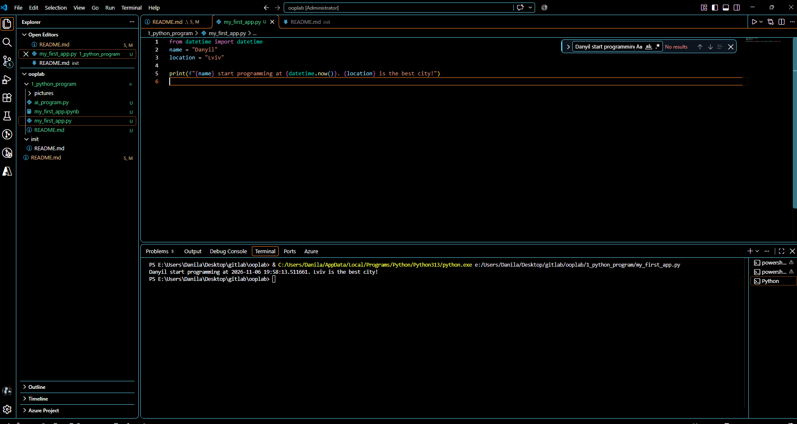
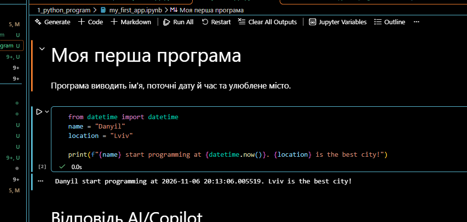
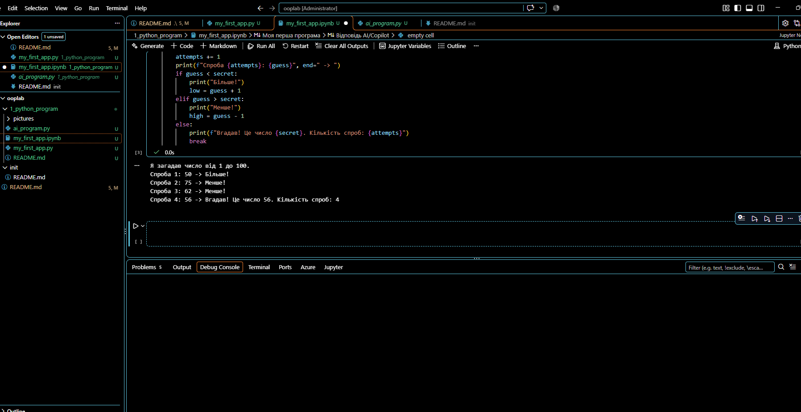

# Звіт до роботи
## Тема: Вступні заняття: налаштування середовища, початок роботи з Python та Markdown
### Мета роботи: налаштувати середовище роботи у VS Code, створити репозиторій GitHub та налаштувати інтеграцію з ним, написати першу програму на Python і створити звіт із використанням форматування Markdown

[⬅ На головну](../README.md)

---
### Виконання роботи

#### 1. Налаштування VS Code
1. Встановили розширення **Python** (разом із ним встановилися **Pylance** та **Python Debugger**); розширення **Jupyter** автоматично не встановилося, тому додали його окремо.
2. Встановили розширення **GitHub Copilot**.
3. Перезавантажили VS Code, перевірили підсвічування коду Python і підказки Copilot.

#### 2. Перша програма на Python (`.py`)
1. Створили файл [my_first_app.py](my_first_app.py) та скопіювали в нього код програми.
2. Змінили значення змінних `name` і `location` на своє ім'я та улюблене місто:
    ```python
    from datetime import datetime
    name = "Danyil"
    location = "Lviv"

    print(f"{name} start programming at {datetime.now()}. {location} is the best city!")
    ```
3. Запустили програму кількома способами:
    - кнопкою `Run Python File` (трикутник :arrow_forward: у правому верхньому куті);
    - з терміналу командою `python my_first_app.py`.
4. Програма вивела:
    ```text
    Danyil start programming at 2026-11-06 19:58:13.511661. Lviv is the best city!
    ```
    

#### 3. Python Notebook (`.ipynb`)
1. Створили файл [my_first_app.ipynb](my_first_app.ipynb), скопіювали код у першу комірку та натиснули `Run All`.
2. Обрали інтерпретатор Python, погодилися встановити бібліотеку `ipykernel`.
3. Програма в комірці вивела:
    ```text
        Danyil start programming at 2026-11-06 20:13:06.005519. Lviv is the best city!
    ```
4. Додали комірку типу `Markdown` з описом коду та оформили його як заголовок `# Моя перша програма`.
5. Після `Run All` Markdown-комірка відображається як відформатований текст, а не як код:

    

#### 4. Програма від AI/Copilot
1. Запит до Copilot: *«Яку першу програму ти написав би на Python і чи зміг би її пояснити?»*
2. Copilot запропонував гру **«Вгадай число»** — файл [ai_program.py](ai_program.py), а також остання комірка в [my_first_app.ipynb](my_first_app.ipynb):
    - `random.randint(1, 100)` загадує випадкове число;
    - цикл `while True` повторює спроби, доки число не вгадано;
    - у [ai_program.py](ai_program.py) `input()` зчитує число користувача, `isdigit()` перевіряє, що введено саме число;
    - у Notebook число вгадує сам комп'ютер методом ділення навпіл;
    - `if / elif / else` підказує «Більше!» або «Менше!»;
    - `break` завершує гру.
3. Перевірили, що програма виконується на нашому комп'ютері:
    ```text
    Я загадав число від 1 до 100.
    Спроба 1: 50 -> Більше!
    Спроба 2: 75 -> Менше!
    Спроба 3: 62 -> Менше!
    Спроба 4: 56 -> Вгадав! Це число 56. Кількість спроб: 4
    ```
    

#### 5. Структура роботи
```text
1_python_program/
├── README.md            # цей звіт
├── my_first_app.py      # перша програма
├── my_first_app.ipynb   # Notebook з виконаними комірками
├── ai_program.py        # програма від AI
└── pictures/            # скріншоти
```

---
### Висновок:
- **Що зроблено:** налаштовано VS Code (розширення Python, Jupyter, Copilot), написано та запущено першу програму на Python у вигляді `.py` файлу та Notebook, оформлено звіт у Markdown і завантажено роботу на GitHub.
- **Чи досягнуто мети:** так, мету роботи досягнуто.
- **Нові знання:** різні способи запуску Python-програм, робота з комірками коду та Markdown у Jupyter Notebook, f-рядки та модуль `datetime`, використання Copilot.
- **Чи вдалося відповісти на всі питання / виконати всі завдання:** так.
- **Складності:** команда `python` спочатку не запускалася (Windows перехоплював її псевдонімом Microsoft Store), довелося додати Python у змінну `PATH`; також потрібно було вибрати інтерпретатор і встановити `ipykernel` для Notebook.
- **Feedback:** формат здачі через GitHub зручний — усі роботи зберігаються в одному місці.
- **Suggestions:** додати більше прикладів готових звітів.