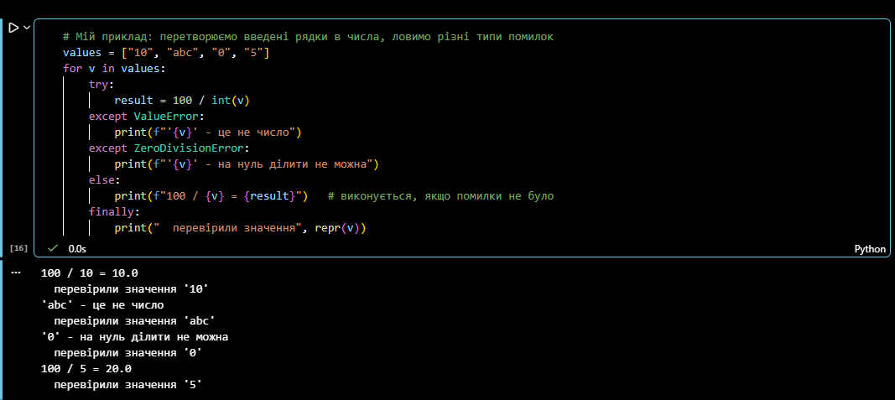

# Звіт до роботи
## Тема: Основи програмування на Python
### Мета роботи: навчитися застосовувати основні конструкції мови Python, виконати всі приклади та за допомогою AI створити власні приклади, які демонструють особливості конструкцій мови Python

[⬅ На головну](../README.md)

---
### Виконання роботи

#### Структура роботи
```text
2_python_basics/
├── README.md        # цей звіт
├── basics.ipynb     # власні приклади до кожного пункту завдання
├── lectures/        # матеріали з лекцій (репозиторій групи 2026_KN31_oop, папка 2_lab)
│   ├── 1.ipynb      # типи даних, колекції, індексація та слайсинг
│   ├── 2.ipynb      # константи True / False / None
│   ├── 3.ipynb      # вбудовані функції, форматування рядків
│   ├── 4.ipynb      # цикли for / while
│   ├── 5.ipynb      # розгалуження, list comprehension
│   ├── 6.ipynb      # обробка помилок, assert
│   ├── 7.ipynb      # робота з файлами, with
│   ├── 8.ipynb      # функції
│   └── numbers.py   # гра «Вгадай число»
└── pictures/        # скріншоти
```

#### 1. Матеріали з лекцій
1. Знайшли в репозиторії групи [2026_KN31_oop](https://github.com/BobasB/2026_KN31_oop/tree/main/2_lab) матеріали, які розбирали на лекціях, і скопіювали їх у папку [lectures](lectures/).
2. Виконали всі комірки в ноутбуках [1](lectures/1.ipynb)–[8](lectures/8.ipynb) та гру [numbers.py](lectures/numbers.py).
3. Для ноутбука [2.ipynb](lectures/2.ipynb) встановили бібліотеку `requests` (`pip install requests`).
4. У [6.ipynb](lectures/6.ipynb) друга комірка навмисно може падати з `ZeroDivisionError` (ділення на випадкове число, серед яких є 0) — далі в ноутбуці показано, як цю помилку обійти через `if` та `try / except`.

    

#### 2. Власні приклади — [basics.ipynb](basics.ipynb)

##### 2.1 Типи даних
```python
student = "Даниїл"                      # str
lessons = 2                             # int - пар на тиждень
average = 4.6                           # float
is_student = True                       # bool
subjects = ["ООП", "Мережі", "СУБД"]    # list - можна змінювати
schedule = ("Пн", "Вт")                 # tuple - не можна змінювати
marks = {"ООП": 5, "Мережі": 4}         # dict - ключ: значення
tags = {"python", "git", "python"}      # set - тільки унікальні значення

subjects.append("Математика")
marks["СУБД"] = 5
print("Предмети:", subjects, "| кількість:", len(subjects))
print("Теги (без повторів):", tags)
print("Перетворення типів:", int("42") + 1, str(3.14) + "!", float(lessons))
```
```text
Предмети: ['ООП', 'Мережі', 'СУБД', 'Математика'] | кількість: 4
Теги (без повторів): {'python', 'git'}
Перетворення типів: 43 3.14! 2.0
```
> У прикладі з методички `f = {"ss", a + b}` дає помилку `TypeError`, бо не можна додати `str` і `int`. Виправили на `a + str(b)`.

##### 2.2 Вбудовані константи та зарезервовані слова
```python
print("True + True =", True + True, "| bool(0) =", bool(0), "| bool('текст') =", bool("текст"))
print("None == False?", None == False, "| not None =", not None)

import keyword
print(f"У Python {len(keyword.kwlist)} зарезервованих слів:")
print(", ".join(keyword.kwlist))
```
```text
True + True = 2 | bool(0) = False | bool('текст') = True
None == False? False | not None = True
У Python 35 зарезервованих слів:
False, None, True, and, as, assert, async, await, break, class, continue, def, del, elif, else, except, finally, for, from, global, if, import, in, is, lambda, nonlocal, not, or, pass, raise, return, try, while, with, yield
```

##### 2.3 Вбудовані функції
```python
numbers = [7, 3, 12, 5, 9]
print("len:", len(numbers), "| sum:", sum(numbers), "| min:", min(numbers), "| max:", max(numbers))
print("Середнє:", round(sum(numbers) / len(numbers), 2))
print("sorted:", sorted(numbers), "| у зворотному порядку:", sorted(numbers, reverse=True))
```
```text
len: 5 | sum: 36 | min: 3 | max: 12
Середнє: 7.2
sorted: [3, 5, 7, 9, 12] | у зворотному порядку: [12, 9, 7, 5, 3]
```

##### 2.4 Цикли
```python
# for + enumerate по словнику
marks = {"ООП": 5, "Мережі": 4, "СУБД": 5}
for n, (subject, mark) in enumerate(marks.items(), start=1):
    print(f"{n}. {subject}: {mark}")

# while + continue + break: перше число, що ділиться і на 7, і на 11
n = 0
while True:
    n += 1
    if n % 7 != 0:
        continue
    if n % 11 == 0:
        print("Знайшли:", n)
        break
```
```text
1. ООП: 5
2. Мережі: 4
3. СУБД: 5
Знайшли: 77
```

##### 2.5 Розгалуження
```python
def grade(points):
    if points >= 90:
        return "A - відмінно"
    elif points >= 75:
        return "B - добре"
    elif points >= 60:
        return "C - задовільно"
    else:
        return "F - не склав"

for p in [95, 80, 61, 40]:
    print(p, "->", grade(p))

for day in [1, 6, 9]:
    match day:
        case 1 | 2 | 3 | 4 | 5:
            print(day, "- робочий день")
        case 6 | 7:
            print(day, "- вихідний")
        case _:
            print(day, "- такого дня немає")
```
```text
95 -> A - відмінно
80 -> B - добре
61 -> C - задовільно
40 -> F - не склав
1 - робочий день
6 - вихідний
9 - такого дня немає
```

##### 2.6 `try` -> `except` -> `finally`
```python
values = ["10", "abc", "0", "5"]
for v in values:
    try:
        result = 100 / int(v)
    except ValueError:
        print(f"'{v}' - це не число")
    except ZeroDivisionError:
        print(f"'{v}' - на нуль ділити не можна")
    else:
        print(f"100 / {v} = {result}")
    finally:
        print("  перевірили значення", repr(v))
```
```text
100 / 10 = 10.0
  перевірили значення '10'
'abc' - це не число
  перевірили значення 'abc'
'0' - на нуль ділити не можна
  перевірили значення '0'
100 / 5 = 20.0
  перевірили значення '5'
```

##### 2.7 Контекстний менеджер `with`
```python
with open("my_notes.txt", "w", encoding="utf-8") as f:
    f.write("Перший рядок\n")
    f.write("Другий рядок\n")
print("Файл закрито?", f.closed)

with open("my_notes.txt", "r", encoding="utf-8") as f:
    for n, line in enumerate(f, start=1):
        print(f"{n})> ", line, end="")
```
```text
Файл закрито? True
1)>  Перший рядок
2)>  Другий рядок
```

##### 2.8 Лямбда-функції
**Як я розумію лямбда-функції:** це коротка функція без імені, записана в один рядок: `lambda аргументи: вираз`. Вона одразу повертає результат виразу, `return` не потрібен. Зручна, коли функція потрібна один раз — наприклад, як ключ сортування в `sorted()` або для `map()` / `filter()`. Для складної логіки краще звичайна функція `def`.
```python
square_lambda = lambda x: x ** 2
print(square_lambda(5))

students = [("Оля", 82), ("Тарас", 95), ("Ігор", 67)]
print("За балом:", sorted(students, key=lambda s: s[1], reverse=True))

nums = [1, 2, 3, 4, 5, 6]
print("Квадрати:", list(map(lambda x: x ** 2, nums)))
print("Тільки парні:", list(filter(lambda x: x % 2 == 0, nums)))
```
```text
25
За балом: [('Тарас', 95), ('Оля', 82), ('Ігор', 67)]
Квадрати: [1, 4, 9, 16, 25, 36]
Тільки парні: [2, 4, 6]
```


#### 3. Основи Python від AI/Copilot
1. Запит до Copilot: *«Я вивчаю Python із використанням Jupyter Notebook. Як би ти описав основи Python? Наведи короткі приклади коду.»*
2. Відповідь Copilot: _(вставити)_
3. Приклад коду з відповіді виконали в останній комірці [basics.ipynb](basics.ipynb):
    ```text
    (вставити результат)
    ```

---
### Висновок:
- **Що зроблено:** виконано всі матеріали з лекцій та власні приклади для кожної основної конструкції Python: типи даних, константи й зарезервовані слова, вбудовані функції, цикли, розгалуження, обробка помилок, контекстний менеджер `with`, лямбда-функції.
- **Чи досягнуто мети:** так.
- **Нові знання:** різниця між змінюваними (`list`, `dict`, `set`) та незмінюваними (`tuple`, `str`) типами, `match`, `else` у циклах і в `try`, лямбда-функції з `sorted`, `map`, `filter`.
- **Чи вдалося виконати всі завдання:** так.
- **Складності:** приклад із методички `{"ss", a + b}` не виконується (`TypeError`), довелося розібратися з перетворенням типів; для одного з лекційних ноутбуків потрібно було встановити бібліотеку `requests`.
- **Feedback:** приклади в Notebook зручно запускати по одній комірці й одразу бачити результат.
- **Suggestions:** —
