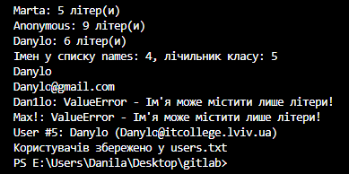

# Звіт до роботи
## Тема: Знайомство з ООП
### Мета роботи: навчитись використовувати основні принципи ООП, розглянути конструкції побудови класу та створення об'єктів і навчитись працювати з ними

[⬅ На головну](../README.md)

---
### Виконання роботи

#### Структура роботи
```text
oop_intro/
├── README.md          # цей звіт
├── oop_intro.py       # клас MyName з індивідуальними завданнями
├── oop_intro.ipynb    # той самий клас + приклади з лекції
├── users.txt          # файл, який створює метод save_to_file()
└── pictures/          # скріншоти
```

#### 1. Перша програма на ООП
1. Створили два файли: [oop_intro.py](oop_intro.py) (скрипт) та [oop_intro.ipynb](oop_intro.ipynb) (Ноутбук).
2. Скопіювали код класу `MyName` у `.py` файл, додали своє ім'я в список `names` і запустили кнопкою `Run Python File`:
    ```python
    names = ("Bohdan", "Marta", None, "Danylo")  # додано своє ім'я
    ```
3. Програма вивела (для кожного об'єкта однаковий блок, нижче — останній і підсумок):
    ```text
    Розпочинаємо створювати обєкти!
    ...
    >*<>*<>*<>*<>*<>*<>*<>*<>*<>*<>*<>*<>*<>*<>*<>*<>*<>*<>*<>*<
    This is object: <__main__.MyName object at 0x...>
    This is object attribute: Danylo / 5
    This is <class 'property'>: My name is Danylo / Danylo@itcollege.lviv.ua
    This is <class 'method'> call: Danylo@itcollege.lviv.ua
    This is static <class 'function'> with defaults: You say: Hello to everyone!
    This is class variable <class 'int'>: from class 5 / from object 5
    <*><*><*><*><*><*><*><*><*><*><*><*><*><*><*><*><*><*><*><*>
    We are done. We create 5 names! ??? Why 5?
    ```
    

#### 2. Що робить кожна частина класу `MyName`
| Конструкція | Що це | Що робить |
|---|---|---|
| `total_names = 0` | змінна класу | спільний лічильник для всіх об'єктів |
| `__init__(self, name=None)` | конструктор | задає `self.name`, збільшує лічильник, записує `self.my_id` |
| `self.name`, `self.my_id` | атрибути об'єкта | у кожного об'єкта свої значення |
| `@property whoami`, `my_email`, `full_name` | властивості | викликаються як атрибути, без дужок: `me.whoami` |
| `create_email()`, `count_letters()`, `save_to_file()` | методи об'єкта | працюють з даними конкретного об'єкта через `self` |
| `@classmethod anonymous_user(cls)` | метод класу | отримує сам клас `cls` і створює з нього новий об'єкт |
| `@staticmethod say_hello()` | статичний метод | не використовує ні `self`, ні `cls`, просто функція всередині класу |

#### 3. Відповіді на запитання та індивідуальні завдання
1. **Чому при `None` створюється об'єкт з іменем Anonymous?**
    У конструкторі стоїть `self.name = name if name is not None else self.anonymous_user().name`. Якщо ім'я `None`, викликається метод класу `anonymous_user()`, який створює **ще один** об'єкт `MyName("Anonymous")`, і з нього береться ім'я `"Anonymous"`.

2. **Як змінити текст привітання `say_hello()`?** У методу є параметр зі значенням за замовчуванням, тому достатньо передати свій текст:
    ```python
    print(MyName.say_hello("Привіт, студенте!"))   # You say: Привіт, студенте!
    ```

3. **Кількість букв імені** — новий метод:
    ```python
    def count_letters(self) -> int:
        return len(self.name)
    ```
    ```text
    Bohdan: 6 літер(и)
    Marta: 5 літер(и)
    Anonymous: 9 літер(и)
    Danylo: 6 літер(и)
    ```

4. **Чому імен у списку 4, а лічильник показує 5?**
    ```text
    Імен у списку names: 4, лічильник класу: 5
    ```
    Для `None` конструктор викликає `anonymous_user()`, а той створює додатковий «прихований» об'єкт `MyName("Anonymous")`. Він теж проходить через `__init__` і збільшує `total_names`. Тому номер 3 дістався прихованому об'єкту, а наш Anonymous отримав `my_id = 4` (див. вивід вище: Bohdan 1, Marta 2, Anonymous 4, Danylo 5). Також `me.total_names` і `MyName.total_names` однакові, бо це одна спільна змінна класу — об'єкт просто читає її з класу.

5. **Ім'я завжди з великої літери** — у `__init__`:
    ```python
    self.name = self.name[0].upper() + self.name[1:]
    ```
    `MyName("danylo").name` → `Danylo`. Використали саме такий варіант, а не `capitalize()`, бо `capitalize()` робить усі інші літери маленькими.

6. **Змінний домен після @** — параметр зі значенням за замовчуванням:
    ```python
    def create_email(self, domain="itcollege.lviv.ua") -> str:
        return f"{self.name}@{domain}"
    ```
    `create_email("gmail.com")` → `Danylo@gmail.com`.

7. **Перевірка імені на цифри та символи:**
    ```python
    if not self.name.isalpha():
        raise ValueError("Ім'я може містити лише літери!")
    ```
    ```text
    Dan1lo: ValueError - Ім'я може містити лише літери!
    Max!: ValueError - Ім'я може містити лише літери!
    ```

8. **Властивість `full_name`:**
    ```python
    @property
    def full_name(self) -> str:
        return f"User #{self.my_id}: {self.name} ({self.my_email})"
    ```
    `User #5: Danylo (Danylo@itcollege.lviv.ua)`

9. **Метод `save_to_file()`** дописує рядок у файл (режим `"a"`), результат — [users.txt](users.txt):
    ```text
    User #1: Bohdan (Bohdan@itcollege.lviv.ua)
    User #2: Marta (Marta@itcollege.lviv.ua)
    User #4: Anonymous (Anonymous@itcollege.lviv.ua)
    User #5: Danylo (Danylo@itcollege.lviv.ua)
    ```
    Оскільки файл відкривається на дописування, кожен новий запуск додає ці рядки ще раз.

#### 4. Приклади з лекції
У [oop_intro.ipynb](oop_intro.ipynb) після класу `MyName` додано приклади з лекції ([2026_KN31_oop / 3_lab](https://github.com/BobasB/2026_KN31_oop/tree/main/3_lab)): оцінки студентів у словнику → порожній клас `Student` з динамічними атрибутами → конструктор `__init__` → перезапис атрибутів → властивості `@property`, які можна читати, але не змінювати.


---
### Висновок:
- **Що зроблено:** створено клас `MyName`, розібрано змінні класу та атрибути об'єкта, властивості, методи об'єкта, класу та статичні методи; виконано всі індивідуальні завдання та приклади з лекції.
- **Чи досягнуто мети:** так.
- **Нові знання:** різниця між `@property`, `@classmethod` і `@staticmethod`; змінна класу спільна для всіх об'єктів; метод класу може створювати нові об'єкти, що впливає на лічильник.
- **Чи вдалося відповісти на всі питання:** так.
- **Складності:** зрозуміти, чому лічильник показує 5 замість 4.
